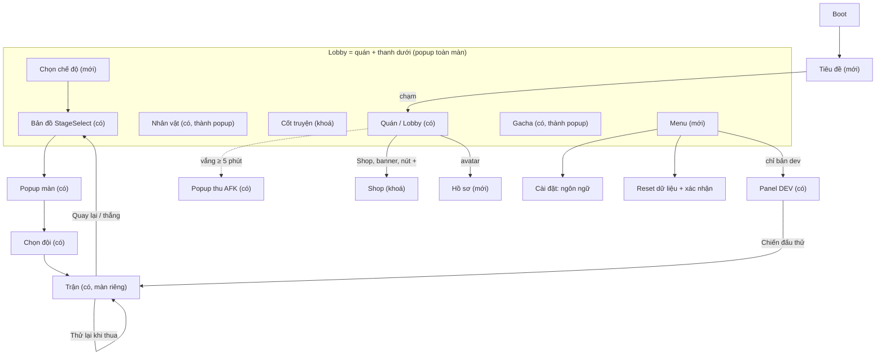

# Luồng màn

> **Đọc khi:** làm UI hub, thêm màn mới, nối các màn với nhau, viết spec có chuyển màn.
> **Cập nhật khi:** user đổi cách đi giữa các màn, thêm hay bỏ một màn. Kênh 🎨 Game designer giữ file này.

Bàn với user và **user duyệt ngày 2026-11-09** (kênh 🎨). Ảnh tham khảo: [ui-screens.md](../references/ui-screens.md). Ý tưởng chưa chốt ở [ideas.md](ideas.md).

Trạng thái: **có** = đã có trong game · **mới** = user chốt, chưa làm · **khoá** = có nút nhưng hiện "sắp có" · **sau** = để sau, chưa hiện.

## Cấu trúc (user chốt 2026-11-09)

1. **Lobby = màn quán.** Quán chạy thật, chiếm cả màn hình, vuốt để kéo camera xem quanh quán.
2. **Các màn khác, trừ Trận, là popup toàn màn phủ lên Lobby.** Quán vẫn chạy bên dưới. Thanh dưới vẫn hiện để đổi mục. Đóng popup hoặc bấm mục Quán thì về Lobby.
3. **Trận là màn riêng.** Không có thanh dưới, không có nút Thông báo. Đánh xong thì về Lobby, popup bản đồ mở sẵn.
4. **Nút Thông báo nằm trên mọi popup**, có số đếm. Bấm vào hiện danh sách việc cần làm, bấm một dòng thì tới đúng chỗ ([mục dưới](#nút-thông-báo)).

## Sơ đồ



## Các màn

| Màn | Mở từ | Quay về | Ảnh `Mota/` | Trạng thái |
|---|---|---|---|---|
| Tiêu đề | Boot, lúc mở app | chạm → Lobby | `title-touch-to-start.jpg` | mới |
| Lobby (quán) | mục **Quán**, đóng mọi popup | — | `hub-home-annotated-en.png`, `restaurant-layout-*` | có (`Restaurant`), cần thêm phần hub |
| Popup thu AFK | tự hiện khi vào Lobby sau khi vắng ≥ 5 phút; dòng AFK trong Thông báo | Lobby | — | có |
| Nhân vật | mục **Nhân vật**; dòng "đủ mảnh" trong Thông báo (chọn sẵn nhân vật đó) | Lobby | `character-list-en.png`, `character-upgrade.png` | có (`Characters`), đổi thành popup |
| Cốt truyện | mục **Cốt truyện** | Lobby | — (thiếu, xem [dưới](#ảnh-còn-thiếu)) | khoá "sắp có" tới khi có hội thoại Chương 1 |
| Chọn chế độ | mục **Màn chơi** | Lobby | `quest-mode-select.jpg` | mới: thẻ "Chương chính" mở, ô khác khoá |
| Bản đồ màn | Chọn chế độ → Chương chính; về từ Trận | Chọn chế độ | `quest-stage-map*.jpg` | có (`StageSelect`), đổi thành popup |
| Popup màn, chọn đội | bấm một nút màn trên bản đồ | Bản đồ | `quest-stage-info-popup.jpg`, `quest-team-select-popup.jpg` | có |
| Trận | chọn đội → vào trận; DEV "Chiến đấu thử" | Quay lại → Bản đồ; Thử lại → trận mới | `battle-*` | có (`Battle`), màn riêng |
| Gacha | mục **Gacha**; banner Gacha ở Lobby | Lobby | `gacha-*` | có (`Gacha`), đổi thành popup |
| Shop | nút tròn Shop; nút + của Thể lực, Coin, Gem | Lobby | — (thiếu) | khoá tới khi làm quảng cáo thưởng / mua |
| Menu | mục **Menu** | đóng → màn đang đứng | — (thiếu) | mới: Cài đặt (ngôn ngữ), Reset dữ liệu (hỏi xác nhận, [D-005](../decisions/decisions.md)), DEV (chỉ bản dev), Đóng |
| Hồ sơ | bấm avatar | Lobby | — (thiếu) | mới: tên người chơi, đổi avatar bằng nhân vật đã có; online thêm ID, tài khoản. Chưa kịp 31/12 thì avatar chỉ là hình |
| Panel DEV | Menu → DEV | Menu | — | có; bỏ nút góc và 4 nút chuyển màn (Quán, Gacha, Màn chơi, Nhân vật); giữ Chiến đấu thử và các nút thử |
| Hộp quà, Thông báo tin, Nhiệm vụ, Hội | nút tròn ở Lobby | Lobby | — | sau, cần online ([ideas](ideas.md#để-sau)) |

Mỗi popup chỉ hiện loại tiền nó dùng (user chốt 2026-11-09). Lobby hiện đủ 4 loại; bản đồ và chọn đội hiện Thể lực; Gacha hiện Gem; Shop hiện Thể lực, Coin, Gem; **Nhân vật hiện Coin**, vì chọn một nhân vật sẽ sang màn nâng cấp nhân vật (`character-upgrade.png`; nâng cấp tốn gì đang bàn ở [ideas](ideas.md#đang-bàn)); Cốt truyện, Menu, Hồ sơ không hiện. Trong cutscene và màn lộ của Gacha thì ẩn thanh dưới và nút Thông báo.

## Bố cục Lobby (user duyệt ảnh mô phỏng bản 2, 2026-11-09)

Khung 1920×1080. Kích thước ghi trong tên là cỡ thật.

```
[Avatar] [Thể lực 80/100 + | Coin + | Material | Gem +]                 [Báo 3]
         [★ chất lượng · ≈ Coin/giây · Phục vụ]
[Banner                                                            ]  [‹]  ← thanh quán thu gọn
 → Gacha]        QUÁN ĐANG CHẠY, FULL MÀN, VUỐT KÉO CAMERA         (mở: Nhân viên,
 ● ○ ○                                                               Nâng cấp, Thu AFK)
                                          (Shop) (Hộp quà) (Thông báo) (Nhiệm vụ) (Hội)
[ Quán | Nhân vật | Cốt truyện (khoá) | Màn chơi | Gacha | Menu ]
```

| Vùng | Tên object | Ghi chú |
|---|---|---|
| Avatar trên-trái | `Avatar_PH_140x140` | bấm mở Hồ sơ |
| Thanh tài nguyên | `ResourceBar_PH_1120x76` | **một** thanh chung: Thể lực x/100, Coin, Material, Gem. Thể lực, Coin, Gem có nút + mở Shop; Material không có |
| Thanh chất lượng | `QualityBar_PH_800x68` | sao chất lượng, Coin/giây, bộ đếm. Chỉ ở Lobby |
| Nút Thông báo trên-phải | `NotifyBtn_PH_110x100` | thay 4 icon nhỏ trong ảnh; có số đếm |
| Banner trái | `BannerGacha_PH_360x200` | giữ chỗ từ giờ, banner đầu trỏ tới Gacha; có chấm trang |
| Thanh quán thu gọn | `RestaurantBarToggle_PH_60x160`, `RestaurantBar_PH_180x460` | 3 nút đã có: Nhân viên, Nâng cấp, Thu AFK. Mặc định đóng, nhớ trạng thái lần trước; có Coin AFK chờ thu thì nút ‹ có chấm báo |
| Hàng nút tròn | `HubRoundBtn_PH_110x110` × 5 | nay chỉ hiện Shop (khoá). 4 ô còn lại giữ chỗ, mở khi có online |
| Thanh dưới | `NavTab_PH_320x120` × 6 | Quán · Nhân vật · Cốt truyện (khoá) · Màn chơi · Gacha · Menu |

Bỏ từ ảnh: cấp và EXP người chơi, Mana, nhân vật lớn và bong bóng thoại, 4 icon nhỏ trên-phải, Guildhouse, Story tách khỏi bản đồ (Cốt truyện ở đây là mục xem lại), Clan và Announcement dạng cũ.

## Nút Thông báo

Danh sách, theo thứ tự (user chốt 2026-11-09):

| Dòng | Bấm thì |
|---|---|
| Sự cố đang chờ | đóng popup, về Lobby, chỉ vào trạm có "!" |
| Quán thiếu người ở một vai (quán đứng yên) | về Lobby, mở bảng Nhân viên |
| Coin AFK chờ thu | mở popup thu AFK |
| Thể lực đầy | mở bản đồ màn |
| Nhân vật đủ mảnh nâng sao | mở Nhân vật, chọn sẵn nhân vật đó |
| Phần thưởng chưa nhận (sau này: Hộp quà, Nhiệm vụ) | mở đúng màn đó |

## Luật đổi theo luồng mới

- **Sự cố khi mở popup** và **chuyên cần**: user chốt 2026-11-09, đã chép sang [game-design.md mục Quán](game-design.md#quán).
- **Thể lực mua được trong Shop** (luật cũ: không mua bằng Gem, [D-008](../decisions/decisions.md)). Mua bằng gì, giá bao nhiêu: `TODO(user)`, xem [ideas](ideas.md#đang-bàn).
- **Online:** user nói game sẽ có online và **xong online trong bản 31/12**. Lệch với [vision](../vision/vision.md) (online đang ở "ngoài phạm vi") và roadmap. Chưa sửa vision.

## Luật làm UI (user đặt 2026-11-09)

- Mọi việc làm UI phải có **ảnh mô phỏng** cho user duyệt trước, rồi mới làm thật.
- Object chưa có hình đặt tên `<Tên>_PH_<rộng>x<cao>`, ví dụ `BannerGacha_PH_360x200`, để user hoặc agent dễ thay hình sau.

Hai luật này áp dụng cho mọi kênh; 🎯 đã ghi vào [unity-workflow.md](../guides/unity-workflow.md#ui-và-hình-tạm) mục "UI và hình tạm" (2026-11-09), nơi đó là bản chính.

## Khác với đề xuất UI hub

Đề xuất của 📐 UI hub (chưa duyệt) so với luồng ở trên:

| 📐 đề xuất | Luồng màn này |
|---|---|
| Thanh 5 mục, Quán là trang chủ | 6 mục: thêm **Cốt truyện** (khoá). Quán là trang chủ: giống |
| Thanh dựng sẵn trong từng scene | Gacha, Nhân vật, Chọn chế độ, Bản đồ, Shop, Menu là **popup toàn màn phủ lên quán**, quán chạy bên dưới. Có thể nạp các scene có sẵn chồng lên Restaurant (additive); việc chọn cách làm là của 📐 |
| Menu mở scene Cài đặt riêng | Menu là **popup**; mở scene khác thì rời quán và huỷ sự cố |
| Panel DEV bỏ nút góc và 4 nút chuyển màn | Giống; panel vào từ dòng **DEV trong Menu** (chỉ bản dev) |
| Trong trận không có thanh | Giống; trận cũng không có nút Thông báo |
| — | Thêm: màn Tiêu đề, màn Chọn chế độ trước bản đồ, avatar và Hồ sơ, nút Thông báo, banner trái, hàng nút tròn (Shop khoá), thanh quán thu gọn, quán full màn kéo camera, thanh tài nguyên chung |
| — | Đổi luật: sự cố khi mở popup, chuyên cần, thể lực mua được (mục trên) |

## Ảnh còn thiếu

User thả vào `Mota/` theo tên gợi ý, agent cập nhật [ui-screens.md](../references/ui-screens.md).

| Màn | Cần ảnh gì | Tên gợi ý |
|---|---|---|
| Shop | trang shop chính: các ô gói, giá, ô xem quảng cáo nhận Gem | `shop-main.jpg` |
| Menu | popup hoặc trang menu: danh sách mục, nút đóng | `menu-popup.jpg` |
| Cài đặt | trang cài đặt: ngôn ngữ, âm thanh | `menu-settings.jpg` |
| Hồ sơ | popup hồ sơ người chơi: avatar, tên, ID | `profile-popup.jpg` |
| Cốt truyện | danh sách chương hoặc đoạn đã xem | `story-list.jpg` |
| Hộp quà | danh sách quà, nút nhận hết | `hub-presents-popup.jpg` |
| Nhiệm vụ | danh sách nhiệm vụ, nút nhận | `hub-missions.jpg` |

## Câu còn chờ user

- Thể lực mua trong Shop bằng gì, giá, giới hạn mỗi ngày.
- Luồng lần đầu chơi (đặt tên, hướng dẫn) chưa bàn.
